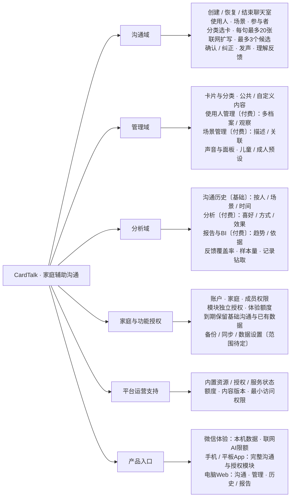
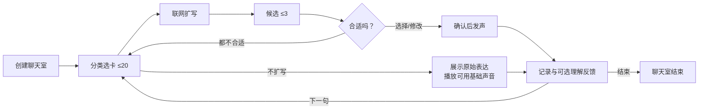

# CardTalk 产品全景设计

版本：0.1；日期：2026-10-12；状态：全景设计草案，等待产品评审。功能均为目标设计，不代表已实现。本次完整描述目标产品，再按依赖分阶段实现。

## 1. 产品定位与已确认范围

CardTalk 面向口语有限的儿童与家庭，以及卒中后有沟通困难的成人与家庭，帮助使用者在生活场景中通过卡片、文字和声音表达自己的意思，帮助家人理解、回应和回顾沟通过程。

产品由沟通域、分析域、管理域组成；家庭协作、功能授权和运营支持为三个域提供公共能力。不是面向诊断名称统一套用的产品：理解、识字、选图、操作和确认能力需要分别适配。

### 已确认

- 手机和平板 App：Android、iOS、HarmonyOS NEXT；电脑端采用 Web；同时支持微信小程序。
- 微信小程序作为单机体验入口：沟通记录和体验配置保存在本机，联网可限额体验 AI；断网不生成新扩写。
- 一次表达最多选择 20 张卡片，模型最多返回 3 个候选，使用者选择合适的候选后发声。
- 扩写参考当前选卡、场景和必要的使用人资料；首期调用大模型 API，不部署本地小模型。
- 声音支持本地或远端方案，按使用人保存声音偏好；具体服务与端能力需验证。
- 使用人管理、场景管理、分析分别作为可单独开启的付费能力；价格、周期、额度和其他功能的收费归属未确定。
- 参考原型仅用于业务逻辑，技术架构、选型和页面风格不继承。
- 主要技术路线已确认，具体框架/模型/TTS版本需验证；Mac 本地开发可访问 Web 和本机后端。

### 当前工作假设

- “聊天室”首先指一次面对面、围绕同一设备发生的沟通会话，不要求参与者各自在线。
- 一次聊天室绑定一个当前表达主体，可有多个普通沟通参与者。切换表达主体建议结束/保存当前聊天室后创建新会话，避免历史归属混淆；这项交互仍需确认。
- “20张”是单次表达输入上限，不是词库大小、页面可见卡片数或聊天室表达次数限制。
- “用户管理”指使用人档案管理，区别于账户登录和家人权限；免费体验仍有儿童/成人预设或默认表达者。
- 历史查看是基础沟通记录能力；分析付费关闭不阻止形成历史。云历史的存储范围与同步授权另行决定。
- 付费家庭能力建议家庭级授权；独立开通、期限和规模仍需确定。

## 2. 全景图



图中“付费”是已确认收费方向；未标付费不自动代表免费。新增功能和收费范围见后续矩阵。阶段表达的是首次交付的范围，各阶段继续使用同一产品体系。

## 3. 角色与使用模式

| 角色 | 主要操作 | 数据归属与边界 |
| --- | --- | --- |
| 使用人/表达者 | 选卡、选择或拒绝候选、发声、纠正 | 自己表达的主体；可以在家人支持下操作，不要求有独立账号 |
| 沟通参与者 | 听取、回应、确认理解、协助澄清 | 不一定是使用人，也不一定是登录成员；可以临时填写称呼 |
| 家庭管理者 | 管理档案、场景、卡片、成员与授权 | 只管理自己有权限的家庭数据 |
| 家人/协助操作者 | 为本人示范、协助选卡、填写观察、理解反馈 | 协助和代操作注明来源，不能默认是本人独立行为 |
| 平台运营者 | 公共内容、额度、授权、服务可用性 | 不默认获得家庭表达内容访问权限 |

### 儿童与成人预设

- 儿童：生活选择、玩耍、兴趣分享、求助、身体感受、情感与拒绝；允许图片/照片为主。
- 成人：照护需求、身体感受、日常安排、家庭聊天、自主决定；允许图片、文字或两者并用。
- 两套预设共享功能，不以诊断直接限制表达。显示密度、文字大小、声音和操作方式按个人适配。
- “表达模式”减少管理干扰；“家庭管理模式”集中资料与设置。进入管理模式的保护方式是建议功能，需多端验证。

## 4. 三个概念必须分开

| 概念 | 示例 | 用途 |
| --- | --- | --- |
| 卡片分类 | 人物、水果/食物、动作、交通工具、身体、情感、地点、时间、否定/边界 | 帮助从词库找到表达线索；可扩展，自定义卡片须有分类 |
| 沟通场景 | 卧室、厨房、公园、课堂 | 提供环境、活动及必要上下文；不是卡片分类 |
| 一次聊天室 | 某使用人与家人在厨房进行的沟通 | 保存主体、参与者、当前场景、逐条表达及开始/结束信息 |

“苹果”属于水果/食物分类，也可在多个场景中出现。场景可以推荐卡片，但不应隐藏全部通用词汇或让本人只能说预设内容。

## 5. 沟通域完整功能

说明：P0技术验证；P1基础闭环与小程序体验；P2移动完整产品及家庭管理；P3分析报告；P4增强协作与运营。阶段不是已完成状态。

| 编号 | 功能 | 完整行为与规则 | 首次阶段 |
| --- | --- | --- | --- |
| C01 | 开始/恢复聊天室 | 选表达者、场景、参与者；默认预设可直接开始；发现未结束会话可继续或结束 | P1 |
| C02 | 分类与搜索选卡 | 分类浏览、关键词搜索；核心卡固定位置；通用卡片始终可达；收藏/最近使用为建议扩展 | P1；增强P2 |
| C03 | 表达组合 | 选1–20张，显示顺序与重复次数；移除、撤销、清空；第21张拒绝且不丢已有输入 | P1 |
| C04 | AI扩写 | 联网提交当次选卡和必要上下文；显示等待、取消、重试；记录模型与请求版本；不自动发声 | P1 |
| C05 | 候选确认与纠正 | 最多3个有实际差异的候选；保留选卡来源；选择、拒绝全部、修改、返回选卡；无有效候选时提示补充 | P1 |
| C06 | 声音合成与播放 | 播放已确认表达，停止、重播；同时只播放一个表达，连续点击停止旧播放；声音可读状态与失败可见 | P1；个人声音P2 |
| C07 | 多轮表达与过程记录 | 一间聊天室可反复表达；每轮独立保留输入、候选、确认、播放和反馈；逐步保存，不等结束才存 | P1 |
| C08 | 理解反馈 | 可选“理解了/需要澄清/没理解/未记录”；反馈者、备注和时间可追溯；不阻塞下一句 | P1；统计P3 |
| C09 | 结束聊天室 | 明确结束，保存已形成记录，取消待处理扩写和播放；结束后查看详情或开始新会话 | P1 |
| C10 | 重用表达 | 历史表达可展示或重新播放；加入常用表达为建议；标记历史上下文，不把旧句子当新扩写 | P2 |
| C11 | 离线基础沟通 | 保留本地已准备卡片、原始表达和可用音频；断网不生成新扩写；原始文本始终可展示 | P1小程序；P2 App |
| C12 | 协助表达与适配 | 最小来源记录区分独立/协助/未知，未确认来源记为未知；可设置图片/文字、密度、文字大小与误触保护；不能默认家人点击就是本人确认 | P1最小来源；P2完整适配 |

### 主流程



### 扩写规则

- “我＋苹果”可生成“我想吃苹果”“我想要苹果”等候选，允许常见语法补全与同义表达。
- 已选明确动作、人物、对象、否定、疼痛、停止、重复含义优先于场景和个人偏好。
- 场景、性格、兴趣、情绪是背景，不是当前意图；不能编造原因、过去经历、具体数量或未提供的事实。
- 参与者在房间里不表示本人要提到他；只在选卡或明确输入引用时纳入候选人物。
- 修改选卡或必要上下文后，旧候选失效；晚到结果不能覆盖新输入或已结束聊天室。
- 不将候选的原始卡片标记当作“语义正确”保证；用户确认、拒绝与纠正始终保留。
- 缺少信息时优先给合理候选，无法形成合理候选时提出简短澄清，避免强迫选择。

### 会话与表达状态

- 聊天室：待开始 → 进行中 → 已结束；异常退出仍为未结束，可恢复。主动放弃草稿要说明保存结果。
- 单次表达：编辑 → 扩写中 → 待确认 → 已确认 → 发声；候选可被拒绝，发声可失败/中断。
- “已确认表达”“播放完成”“对方理解”是独立事实，不能合并成一个成功状态。
- 场景变更按表达保留快照；表达主体变更的具体会话切换规则待确认，先保证归属不混淆。

## 6. 管理域完整功能

| 编号 | 功能 | 完整行为与规则 | 收费状态 | 首次阶段 |
| --- | --- | --- | --- | --- |
| M01 | 公共卡片与分类 | 内置词库和分类；图像/照片/文字、含义说明、适用语言；公共内容版本可追溯 | 基础预置 | P1 |
| M02 | 自定义卡片 | 新建/编辑文字、图片、含义、分类；关联场景；预览与发声；停用/归档，重复提示 | 待定 | P2 |
| M03 | 内置场景 | 卧室、厨房、公园、课堂等预置；支持选择无场景；提供简短背景 | 基础预置 | P1 |
| M04 | 自定义场景管理 | 名称、描述、常见活动/物品、推荐卡片；编辑、停用、归档；必要描述供扩写 | 已定付费 | P2 |
| M05 | 使用人体验预设 | 儿童/成人或默认表达者；无需先建立完整档案才能沟通 | 基础体验 | P1 |
| M06 | 多使用人管理 | 为多个老人/孩子建档，维护称呼、年龄、语言、操作偏好、声音；切换表达者；归档 | 已定付费 | P2 |
| M07 | 家人观察与沟通资料 | 兴趣、性格/沟通习惯、情绪观察、有效期；填写者与时间；当前状态和长期观察分开 | 使用人管理范围建议 | P2 |
| M08 | 声音偏好 | 选择/试听可用声音、语速和音量；保存个人默认值；能力不可用时说明替代方式 | 基础与高级分界待定 | P2 |
| M09 | 沟通面板与适配 | 常用卡片、核心卡稳定位置、图片/文字、卡片密度、触摸设置；布局调整应明确保存 | 高级归属待定 | P2 |
| M10 | 资料关联与版本 | 删/停用场景、卡片、使用人时修复当前引用；历史继续显示当时内容；永久删除另行确认 | 产品一致性要求 | P2 |

### 使用人资料

- 基本信息：称呼、年龄/年龄段、沟通语言、可选头像及必要说明，不强制填写诊断。
- 沟通偏好：图片/文字方式、常用词、输入适配和声音偏好。
- 观察资料：家人填写的爱好、沟通习惯、性格描述、当前情绪；注明来源和时效。
- AI 只使用与当前表达相关的必要字段；不把整份档案、照片或历史全部发送给模型。
- 账户、普通参与者和需要AAC支持的使用人分别建模；不要求所有家人都购买/建立使用人档案。

### 卡片与场景生命周期

- 公共卡片和家庭自定义卡片有来源、创建/修改信息；图片的使用权需明确。
- 普通删除优先归档/停用，历史保留快照；永久删除本人数据另走数据管理规则。
- 场景卡片关联帮助推荐，不限制原有通用表达能力。
- 不因使用人/场景管理未开通而阻止使用默认表达者和内置场景。

## 7. 分析域完整功能

| 编号 | 功能 | 完整行为与规则 | 收费状态 | 首次阶段 |
| --- | --- | --- | --- | --- |
| A01 | 沟通历史列表 | 按使用人、时间、场景、会话状态筛选；本机与云端保存位置明确 | 基础查看；云范围待定 | P1本机；P2家庭 |
| A02 | 会话/表达详情 | 原始卡片、所有候选、最终选择、是否编辑、协助者、声音结果、反馈和快照 | 基础追溯 | P1 |
| A03 | 使用概览 | 会话数、表达数、活跃日期、常用场景；以明确分母呈现 | 已定分析付费 | P3 |
| A04 | 表达喜好分析 | 实际所选卡片/最终确认表达、常谈话题、场景关联；未选候选不计本人偏好 | 已定分析付费 | P3 |
| A05 | 表达方式分析 | 卡片数量、修改次数、表达耗时、AI依赖/拒绝、独立或协助情况 | 已定分析付费 | P3 |
| A06 | 沟通效果分析 | 理解反馈、澄清轮次、未理解比例；展示反馈覆盖率；播放结果单独统计 | 已定分析付费 | P3 |
| A07 | 分析报告 | 选择使用人和时间范围，生成/保存报告；统计事实与解释分开，关联依据 | 已定分析付费 | P3 |
| A08 | BI报表 | 按时间、场景、分类、独立/协助等维度查看趋势，钻取到相关记录 | 已定分析付费 | P3 |
| A09 | 报告导出与分享 | 选择报告/记录范围，控制收件人可见内容；导出文件或受控分享 | 分析扩展；形式待定 | P4 |
| A10 | 分析质量与更正 | 少样本提示、缺失反馈说明、协助来源区分；更正反馈后重新统计 | 分析组成部分 | P3 |

### 历史应保留什么

| 层级 | 内容 |
| --- | --- |
| 会话 | 使用人、场景、参与者、开始/结束、保存位置、未结束状态 |
| 原始表达 | 按顺序的卡片、重复选择、操作/协助来源、当时文字与上下文快照 |
| 扩写尝试 | 候选、拒绝/选择/编辑、模型/提示版本、请求编号、等待时间与错误 |
| 最终表达 | 本人确认文本、确认来源、与原始输入和候选关联 |
| 发声 | 合成/播放开始、完成、失败、中断；声音配置快照 |
| 理解反馈 | 理解/需澄清/未理解/未记录、反馈者、时间和可选备注 |

普通设置中的“保存本机历史”与“允许云同步”分别处理；试用模式后端不建沟通历史。体验服务只保留必要的身份/额度元数据，内容临时转发给模型；第三方数据处理策略需要另行说明。

### 报告示例结构

1. 使用人、时间范围、记录数、反馈覆盖率。
2. 常用卡片/场景及确认表达，用实际记录说明。
3. 表达方式变化：输入长度、修改/澄清、独立与协助。
4. 有反馈记录中的理解情况；缺失数据明确列出。
5. 可供家人尝试的沟通调整建议，注明是建议而非疗效判断。
6. 关联记录、计算口径与报告生成时间，允许重新生成。

不输出诊断、能力等级或“性格/情绪结论”；不以 AI 编出的句子或低样本给本人贴标签。AI叙述报告是对可核实统计的解释，不能补造数据。

## 8. 家庭、授权与数据公共能力

以下扩展用于支持完整产品，具体商业归属未定；不新增一批默认收费项。

| 编号 | 功能 | 目标行为 | 首次阶段 |
| --- | --- | --- | --- |
| S01 | 体验身份与账户 | 体验额度凭证与内容分开；基础体验不强制完成家庭建档；完整家庭账户绑定方式待选 | P1体验；P2家庭 |
| S02 | 家庭成员与访问权限 | 家庭管理者、普通成员、协助者；邀请、移除、逐使用人访问范围；权限以服务端为准 | P2 |
| S03 | 功能授权中心 | 使用人管理、场景管理、分析分别开启；开放状态/购买授权/成员权限分别控制 | P1接口；P2完整 |
| S04 | 额度、试用与到期 | 体验额度、剩余额度、有效期；请求重试去重；到期保留基础表达与已有数据 | P1额度；P2授权 |
| S05 | 云备份/跨端同步 | 选择是否启用，展示保存位置与状态；本机体验历史显式选择导入范围 | P4；收费待定 |
| S06 | 数据设置与管理 | 查看/导出本人数据、清除本机数据、永久删除申请、保留周期、权限变更说明 | P2；增强P4 |
| S07 | 购买与授权生命周期 | 购买、试用、续期、取消、退款后的授权变化；渠道合规与支付形式另行核实 | P4 |
| S08 | 帮助与反馈 | 家人示范指南、操作帮助、问题反馈；反馈不默认附带沟通内容 | P1基础；P4运营 |

### 独立开通的规则

| 授权组合 | 产品应能做什么 |
| --- | --- |
| 全部关闭 | 默认表达者＋内置场景＋基础历史＋限额联网AI，完成沟通闭环 |
| 仅使用人管理 | 管理多个表达者；继续使用内置场景；没有分析报告 |
| 仅场景管理 | 默认表达者使用自定义场景；没有多档案要求 |
| 仅分析 | 分析默认表达者已有且允许参与分析的记录；不要求先购买多使用人或场景管理 |
| 任意组合 | 模块按实际授权和成员权限组合，不通过隐含依赖强制捆绑 |
| 任意模块到期 | 保留当前沟通和已有数据；限制新增高级操作的策略在商业规则中明确 |

分析开启后如需云端处理本机历史，要明确选择上传范围；仅购买授权不自动开启云同步。基础历史始终不等于云端存储免费无限。

### 收费决策表

- 已确定可独立收费：使用人管理、场景管理、分析（含报告与BI）。
- 未确定：自定义卡片、高级布局、声音、AI高级额度、备份同步、导出分享、家庭成员规模。
- 未确定：价格、周期、试用时长、授权粒度、AI额度分配及失败扣额政策。
- 建议：失败/取消请求不按“成功扩写”扣次；具体供应商成本、限流和防滥用策略需要单独设计。
- 基础表达不因额度用尽而消失；支付/升级提示放在家庭区或明确状态处，不打断本人表达。

## 9. 平台运营支持（全景建议）

| 编号 | 功能 | 范围 | 阶段 |
| --- | --- | --- | --- |
| O01 | 授权与额度管理 | 人工开通测试/试用、模块有效期、额度调整和操作审计；与支付系统分离 | P1开发支持；P2正式 |
| O02 | 公共内容管理 | 公共分类/卡片/场景/声音说明，素材使用权与版本；发布和回滚 | P1内置；P4管理入口 |
| O03 | AI/语音服务管理 | 可用状态、接口配置、费用/性能统计、请求错误；不默认记录表达正文 | P1必要；P4运营 |
| O04 | 内容与问题反馈 | 自定义共享内容若开放，需审核机制；问题处理先经用户选择附带内容 | P4；共享范围待定 |
| O05 | 版本与支持 | 多端版本兼容、帮助内容、服务维护公告、数据迁移验证 | P4 |

运营人员不默认查看所有家庭沟通；支持诊断问题时使用请求编号、错误类型等最小信息。模型密钥不出现在任何客户端设置中。

## 10. 多端与体验版功能矩阵

| 能力 | 微信小程序体验 | 手机/平板App目标 | 电脑Web目标 |
| --- | --- | --- | --- |
| 基础选卡与沟通 | 支持 | 支持 | 支持，鼠标/键盘适配 |
| AI扩写 | 联网限额 | 联网，按额度/授权 | 联网，按额度/授权 |
| 本地记录 | 本机保存 | 本地优先；云范围按授权/选择 | 浏览器本机或家庭云模式明确区分 |
| 离线基础能力 | 资源已准备且仍保留时可用 | 已准备的卡片/文字/本地声音可用 | 首版不承诺完整离线；另行验证 |
| 任意文字发声 | 远端/缓存音频方案待验证 | 系统声音与远端适配 | 浏览器声音或远端适配 |
| 使用人/场景管理 | 体验版不提供高级管理；可解释升级入口 | 独立授权开启 | 独立授权开启，适合编辑 |
| 分析报告/BI | 体验版不运行云分析 | 授权后查看/操作 | 授权后完整浏览、筛选与钻取 |
| 云同步与本机导入 | 不自动同步；未来跨端导入待确认 | 需显式启用 | 需显式启用 |

- 多端共享产品逻辑，不承诺所有端使用相同语音/存储实现。
- 微信首次使用或缓存清理后需要取得代码和资源，不能承诺永久离线启动；本机记录不是可靠云备份。
- 小程序“单机”指资料和历史的保存策略；联网 AI 会发送当次必要输入供模型处理，额度身份元数据在服务端保存。
- 包内/已保存词语和短句音频可作为离线发声候选方案，须验证路径、连续播放和清理行为；不承诺任意新句子离线合成。

## 11. 页面与导航全景

```text
表达入口
├─ 开始/继续沟通
├─ 创建聊天室：表达者、场景、参与者
├─ 沟通工作区：分类、搜索、卡片、表达条
├─ 候选确认与发声（属于沟通工作区）
├─ 理解反馈与下一句
└─ 结束与本次回顾

家庭入口
├─ 沟通历史 → 聊天室详情 → 表达详情
├─ 使用人〔付费〕 → 档案、观察、声音/操作偏好
├─ 卡片 → 分类、公共词库、自定义、归档
├─ 场景〔管理付费〕 → 预置、自定义、卡片关联
├─ 分析〔付费〕 → 概览、方式/喜好/效果、报告、BI
├─ 家庭 → 成员与访问权限
├─ 功能与授权 → 开通状态、试用、额度、到期说明
└─ 设置与帮助 → 数据保存、声音、适配、备份/导入、帮助

运营入口〔独立于家庭侧〕
└─ 公共内容、授权与额度、服务状态、问题处理与版本
```

小程序体验入口保留开始体验、本机历史、体验设置/额度和帮助；不把完整管理导航塞入表达侧。具体布局和视觉在下一阶段设计。

## 12. 异常与数据生命周期

| 情况 | 产品结果 |
| --- | --- |
| 空输入或第21张卡片 | 不请求模型；明确提示且保留已有选卡 |
| AI超时、格式无效、候选都不合适 | 保留输入，可取消/重试/纠正或原始展示 |
| 更新选卡/场景/主体，或结束会话 | 旧请求失效，迟到结果不恢复会话、不播放 |
| 网络切换或重复提交 | 同一请求去重，避免重复记录/扣额 |
| 声音合成失败或播放中断 | 已确认文本仍可读，可停止/重播，不算理解成功 |
| 退出、切后台、崩溃 | 已形成记录逐步保存；恢复未结束状态 |
| 管理资料修改/归档 | 历史保留当时快照；当前失效关联提示修复 |
| 本机清理或换设备 | 明确恢复条件；没有备份则不可承诺找回 |
| 成员被移除/权限改变 | 终止后续云访问；已下载资料的清理/保留规则需确认 |
| 数据不足、反馈缺失 | 展示覆盖范围与不足，不输出肯定性心理/能力结论 |
| 授权到期 | 当前表达不突然中断，基础功能和已有数据保留 |
| 开启同步或分析 | 不默认上传全部历史；先明确选择保存/分析范围 |

体验版的本机存储不自动转成家庭云数据库；开通付费功能与上传历史是独立动作。历史删除、更正和重新分析应能追溯其影响，保留策略由产品政策确定。

## 13. 分阶段实现路线

| 阶段 | 用户得到什么 | 包含 | 验收出口 |
| --- | --- | --- | --- |
| P0 技术与内容验证 | 可确认目标端能承载基础体验 | 跨端构建、卡片/语音/保存验证；初始词库分类和场景；API与声音候选评测 | 目标端能力/限制有证据，未通过项明确处理路径 |
| P1 沟通闭环与体验版 | 在小程序/Web完成一次真实沟通 | C01–C09基础、内置预设、20/3限制、在线API、基础发声、本机历史、额度服务；Mac本地运行 | 可选卡→候选→确认→发声→反馈→结束；失败可恢复 |
| P2 移动完整产品与家庭管理 | 手机/平板长期使用，多人和自定义内容 | Android/iOS/HarmonyNEXT真机覆盖、使用人/场景独立授权、卡片管理、适配、家庭权限、历史与声音配置 | 三个管理授权组合不阻塞基础沟通，记录按主体归属 |
| P3 分析报告与BI | 看见表达习惯和有依据的沟通效果 | A03–A08、A10、统计口径、报告依据、低样本提示、分析独立授权 | 指标可回溯记录，播放与理解分开，分析单独开启可用 |
| P4 增强协作与运营 | 可靠跨端协作与商业运营 | 可选云备份/同步、导入、导出分享、支付生命周期、资源运营、帮助支持 | 显式同步、权限验证、迁移可恢复；支付授权一致 |

说明：P1 为构建完整产品的起点，不将未实现的管理/分析从全景删除；P2–P4按依赖推进。支付上线与平台渠道规则、真实价格另行评审；前期可以用测试授权验证所有模块。

### 每阶段必须保留的约束

1. 原始选卡可见，最多20张；最多3个候选且确认后发声。
2. 失去网络或额度时基础表达仍可展示；实际声音能力如实说明。
3. 原始输入、AI候选、最终确认、协助来源和理解反馈彼此可区分。
4. 体验版不默认形成云端沟通历史。
5. 付费管理/分析可单独开启，基础历史不被分析付费锁住。
6. 儿童与成人都进入样例与验收，不能只有儿童词库通过就称支持两类人群。

## 14. 原始需求覆盖索引

| 用户原需求 | 设计位置 |
| --- | --- |
| 沟通1：创建聊天室、场景、使用人、参与者 | C01、角色、会话状态 |
| 沟通2：20张以内选卡 | C03、扩写验收 |
| 沟通3：水果/动作/交通/情感等分类 | C02、M01、三个概念区分 |
| 沟通4：AI基于卡片扩写 | C04、扩写规则；最新决定采用API |
| 沟通5：最多3候选供本人选 | C05、主流程 |
| 沟通6：按使用人信息选择声音并播放 | C06、M08；选择声音、不引入克隆 |
| 沟通7：结束聊天室 | C09、会话与异常状态 |
| 分析1：不同使用人所有历史/记录 | A01、A02、历史内容与权限 |
| 分析2：偏好/方式/效果报告和BI | A03–A10、报告结构 |
| 管理1：卡片管理、自定义 | M01、M02、卡片生命周期 |
| 管理2：场景描述支持扩写 | M03、M04、扩写上下文规则 |
| 管理3：多个使用人与爱好/性格/情绪 | M05–M08、资料来源与时效 |
| 微信单机体验、联网限额AI | 平台矩阵、C11、S01/S04、数据策略 |
| 使用人/场景/分析付费单独开启 | 独立授权组合、收费决策表、S03 |
| Mac部署前访问 | P1本地Web与后端；使用联网API |

## 15. 待确认与未来扩展

### 不阻挡绘制全景，但在实现相应能力前确认

- 远程实时加入/回复是否需要；当前聊天室只表示同机面对面会话。
- 是否允许聊天室内切换多个表达主体，如何保证历史逐轮归属；当前建议一个聊天室一个主体。
- 付费按家庭/账户/使用人哪种范围，额度周期和失败扣额；基础与高级功能的确切界线。
- 小程序是否始终只提供体验版，还是未来在小程序内解锁高级能力；目前采用前者，跨端升级不等同于小程序全功能。
- 备份同步、导出分享、成员规模、自定义卡片及声音的收费归属。
- 资料保留/永久删除、成员移除后本机数据处理、第三方AI/TTS留存说明。
- 真实词库/符号素材、适配布局、品牌视觉和各端无障碍能力。

### 未来可选，不计入已确认阶段承诺

- 不同设备实时聊天室、远程家人文字回复。
- 外接开关扫描/眼控等特殊输入适配。
- 机构/课堂组织管理、公共卡片市场或共享内容社区。

声音克隆、自动诊断/康复评估、AI自动代本人表达、本地小模型和原生桌面客户端均不在首期设计范围。未来扩展需要独立论证，不能因为图景完整就自动开发。

## 16. 全景评审与验收清单

- [ ] 原始12项域需求均能在覆盖索引找到功能编号。
- [ ] 无付费能力也能完成基础沟通；三项付费能力可分别开启。
- [ ] 图、功能矩阵、端能力和阶段名称一致，建议与已确认决定清楚区分。
- [ ] 卡片分类、场景、聊天室、使用人和账户互不混淆。
- [ ] 小程序本机数据与在线模型请求边界一致，不声称永久离线或绝不传输输入。
- [ ] 历史输入/候选/确认/声音/反馈可区分，数据不足不产生肯定性分析。
- [ ] 断网、超时、停止、重试、切换主体、退出和到期不丢当前基础表达。
- [ ] 多端/双人群纳入后续实际验收，文档不冒充实现证据。
